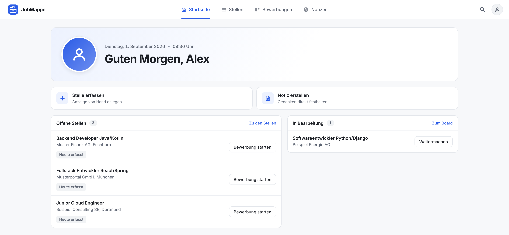
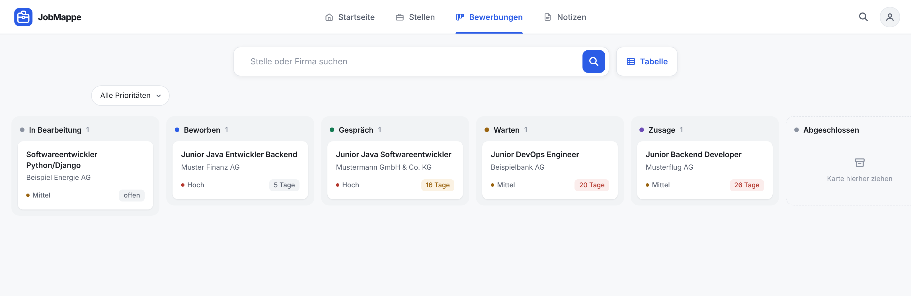
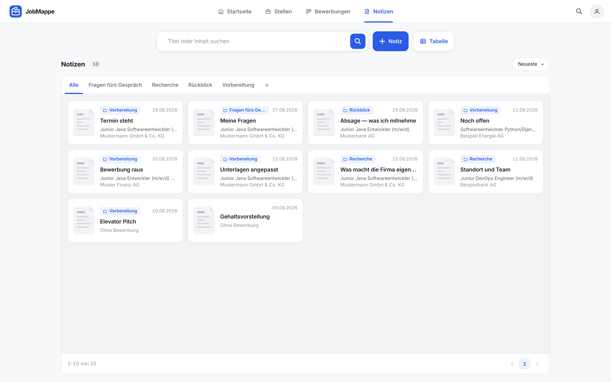
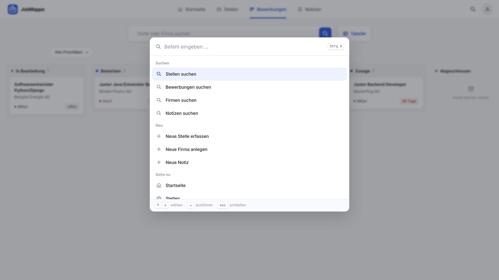
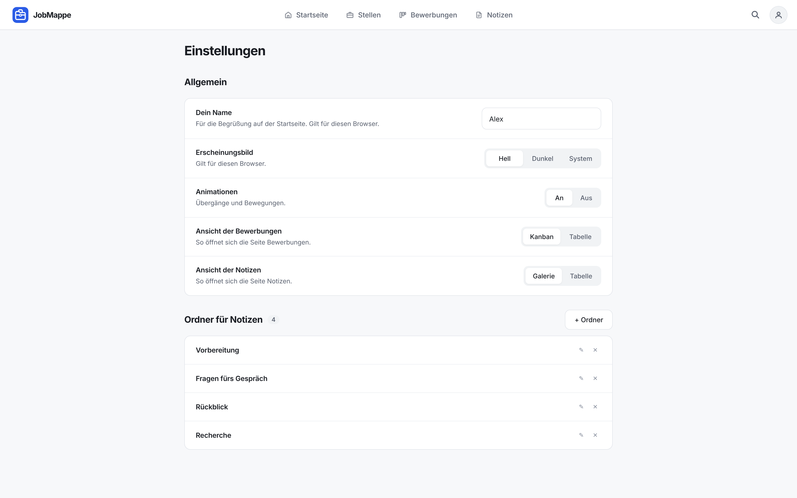
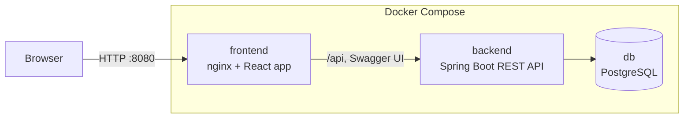

<p align="center">
  <picture>
    <source media="(prefers-color-scheme: dark)" srcset="./docs/logo-mark-dark.svg">
    
  </picture>
</p>

<h1 align="center">JobMappe</h1>

<p align="center">
  <strong>A self-hosted job-application tracker for the German job market</strong><br>
  Job postings, companies, applications and notes in one place, from the first draft to the final answer.<br><br>
  <a href="#self-hosting"><strong>Self-hosting</strong></a> ·
  <a href="https://github.com/hakikafetzi/jobmappe-backend"><strong>Backend (Spring Boot)</strong></a> ·
  <a href="https://github.com/hakikafetzi/jobmappe-frontend"><strong>Frontend (React)</strong></a>
</p>

<p align="center">
  <a href="https://github.com/hakikafetzi/jobmappe-backend/releases"></a>
  
  
</p>

---



## About

A job search quickly turns into a mess of browser tabs, spreadsheets and notes: Which postings did I find? Where did I apply, and when? Who hasn't answered yet? **JobMappe** keeps all of it in one place: the postings you found, the companies behind them, where each application stands and the notes you take along the way.

I built JobMappe for my own job search and as a learning project. It runs on your own machine or server with Docker; your data stays with you. The user interface is in German.

> All screenshots show fictional sample data.

## Table of contents

- [Features](#features)
- [Screenshots](#screenshots)
- [Architecture](#architecture)
- [Self-hosting](#self-hosting)
- [Configuration](#configuration)
- [Operation](#operation)
- [Project status and roadmap](#project-status-and-roadmap)
- [How it was built](#how-it-was-built)
- [License](#license)
- [Author](#author)

## Features

### Job postings and companies

- Capture job postings with title, company, location, link and description.
- Filter postings (open, with application, inactive, archived, all), search by title or company and sort them.
- Archive postings you are no longer interested in, and restore them later.
- Company pages with address, website and all their postings.

### Applications

- Start an application from any posting.
- Track status (in progress, applied, waiting, interview, offer, closed with outcome) and priority.
- Kanban board with drag and drop, or a sortable table with status and priority filters.
- Status changes follow fixed rules, e.g. closing an application asks for the outcome, and closed applications can be reopened.
- Record how you applied (online portal, e-mail, phone, …) and the link to the application portal.
- Applications without a reply for too long are highlighted as overdue.

### Notes

- Notes with your own folders, optionally assigned to an application.
- Rich-text editor that stores Markdown.
- Floating note windows that stay open while you move through the app.

### Everyday use

- Command palette (⌘K / Ctrl+K) and keyboard shortcuts.
- Light and dark mode, responsive layout for phone and desktop.
- Documented REST API with Swagger UI.

## Screenshots

| Applications board                                       | Job postings                                   |
| -------------------------------------------------------- | ---------------------------------------------- |
|         |  |
| **Application detail**                                   | **Notes**                                      |
|   |            |
| **Command palette**                                      | **Settings**                                   |
|  |      |

## Architecture



- Only the **frontend** is reachable from outside. Its nginx serves the React app and forwards `/api` and Swagger UI to the backend.
- The **backend** and the **database** are only reachable inside Docker; the database sits in an internal network that the frontend cannot reach.
- Data is stored in a Docker volume and survives restarts and updates.

| Repository | Content |
| --- | --- |
| [`jobmappe`](https://github.com/hakikafetzi/jobmappe) | This overview and the Docker Compose setup |
| [`jobmappe-backend`](https://github.com/hakikafetzi/jobmappe-backend) | REST API: Java 21, Spring Boot 4, PostgreSQL, Flyway |
| [`jobmappe-frontend`](https://github.com/hakikafetzi/jobmappe-frontend) | Web app: React 19, TypeScript, Vite, TanStack Query |

Both images are published for `linux/amd64` and `linux/arm64` to GitHub Container Registry.

## Self-hosting

### Requirements

- [Docker](https://docs.docker.com/get-docker/) with Docker Compose (included in Docker Desktop)

### Quick start

```bash
git clone https://github.com/hakikafetzi/jobmappe.git
cd jobmappe
cp .env.example .env
```

Set a database password in `.env`, for example generated with:

```bash
openssl rand -base64 24
```

Start JobMappe:

```bash
docker compose up -d
```

After about half a minute, all services are healthy (`docker compose ps`), and JobMappe runs on **<http://localhost:8080>**. Swagger UI is available at <http://localhost:8080/swagger-ui.html>.

## Configuration

All settings are in `.env` (see [`.env.example`](.env.example)):

| Variable | Default | Description |
| --- | --- | --- |
| `DB_PASSWORD` | – | **Required.** Password of the database user |
| `JOBMAPPE_VERSION` | `latest` | Image version of backend and frontend. Pin a release (e.g. `1.0.0`) so updates only happen when you want them |
| `JOBMAPPE_PORT` | `8080` | Port on the host. Use `127.0.0.1:8080` to make JobMappe reachable only from the machine itself, e.g. behind a reverse proxy |
| `DB_NAME` | `jobmappe` | Database name |
| `DB_USER` | `jobmappe` | Database user |
| `COMPOSE_PROJECT_NAME` | `jobmappe` | Project name; a different name allows a second, separate instance (in its own folder, with its own `.env` and port) |

> The database password is only applied when the database is created for the first time. Changing `DB_PASSWORD` later does not change it in the existing database, and the backend can no longer connect.

## Operation

### Updates

1. Back up your data (see below).
2. Set the new version in `.env`, e.g. `JOBMAPPE_VERSION=1.1.0`.
3. Pull and restart:

   ```bash
   docker compose pull
   docker compose up -d
   ```

Database migrations run automatically when the backend starts. Releases and changes are listed on the [releases page](https://github.com/hakikafetzi/jobmappe-backend/releases).

### Backup and restore

Create a backup (replace `jobmappe` if you changed `DB_USER` or `DB_NAME`):

```bash
docker compose exec -T db pg_dump -U jobmappe -d jobmappe > jobmappe-backup.sql
```

Restore it into a new, empty database:

```bash
docker compose down -v          # removes the existing data!
docker compose up -d db         # start only the database
docker compose exec -T db psql -U jobmappe -d jobmappe < jobmappe-backup.sql
docker compose up -d            # start backend and frontend
```

Restore before the backend starts, so it finds the existing schema instead of creating a new one.

### Behind a reverse proxy

To use JobMappe with your own domain and HTTPS, put a reverse proxy in front of it (e.g. Nginx Proxy Manager, Caddy, Traefik or Cloudflare Tunnel) and forward it to `http://<host>:8080`.

The proxy should pass the original `Host` header and `X-Forwarded-Proto`, which common proxies do by default. JobMappe uses them to build correct links (e.g. in Swagger UI). JobMappe has no login yet, so only expose it on networks you trust.

### Disable Swagger UI

Swagger UI and the API documentation are enabled by default. To disable them, add to the `backend` service in `docker-compose.yaml`:

```yaml
    environment:
      SPRINGDOC_SWAGGER_UI_ENABLED: "false"
      SPRINGDOC_API_DOCS_ENABLED: "false"
```

### Logs

```bash
docker compose logs -f backend
```

## Project status and roadmap

**Version 1** covers tracking: job postings, companies, applications and notes.

Planned next:

- Browser extension to capture job postings directly from job boards
- Profile with experience, projects, education and skills
- CV and cover letter generator per application
- User accounts and login
- Match score between a job posting and your profile

## How it was built

The [backend](https://github.com/hakikafetzi/jobmappe-backend) is my own work: I wrote it to build a solid foundation in Spring Boot. The [frontend](https://github.com/hakikafetzi/jobmappe-frontend) was built with an AI coding agent under my direction; its README describes [how that worked](https://github.com/hakikafetzi/jobmappe-frontend#ai-assisted-development).

## License

[MIT](LICENSE) © 2026 Haki Kafetzi

## Author

**Haki Kafetzi** · [GitHub](https://github.com/hakikafetzi) · [LinkedIn](https://www.linkedin.com/in/hakikafetzi)